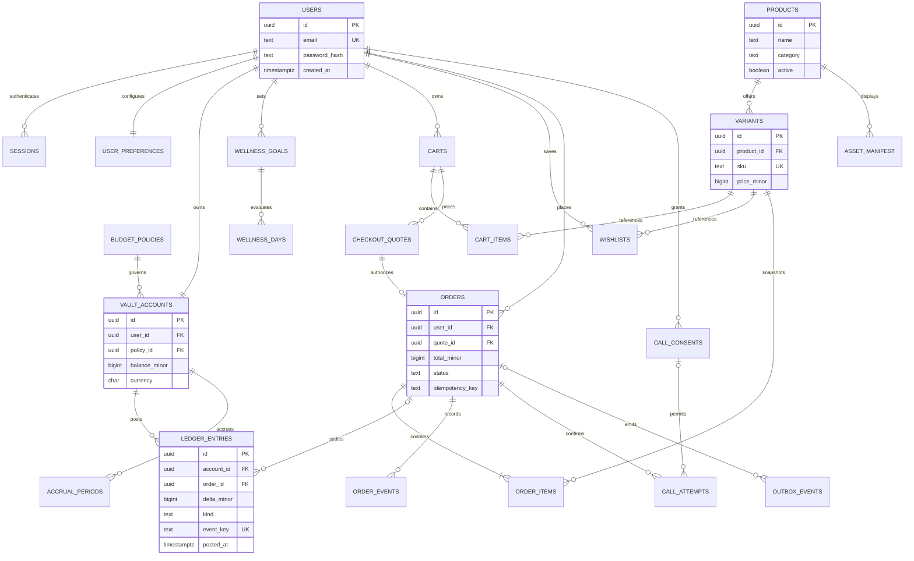

# Database architecture
Version 1.0 | Proposed PostgreSQL 16 relational schema; SQLAlchemy 2 and Alembic. UUID PKs, timestamptz UTC, integer bigint minor units for money, ISO currency code, explicit simulation. No real card or shipping data.
## ERD

## Logical data dictionary
All tables have UUID id unless composite key specified. Required FKs NOT NULL except optional relations noted. Timestamps default server time; mutable entities include updated_at.
| Table | Additional fields and rules |
|---|---|
| users | normalized unique email, password_hash, display_name, role shopper/admin, status, created_at |
| sessions | user_id, unique token_hash, expires_at, revoked_at nullable |
| user_preferences | unique user_id, timezone IANA, locale, reduced_motion, audio_enabled, ambience/interaction/voice volume 0..1 |
| budget_policies | version unique, currency, opening_minor, daily_minor, weekly_bonus_minor, monthly_bonus_minor, bonus_cap_minor, effective_at; nonnegative; immutable versions |
| vault_accounts | unique user_id, policy_id, currency, balance_minor >=0, accrual_cursor UTC |
| ledger_entries | account_id, optional order_id, signed nonzero delta_minor, kind opening/income/bonus/purchase/refund, unique event_key, posted_at; append-only |
| accrual_periods | account_id, policy_id, period_start/end UTC, kind, amount_minor >=0; unique(account_id,period_start,kind); end > start |
| wellness_goals | user_id, daily_limit_minor >=0, effective_from/to, bonus_enabled, paused; no overlapping active goals |
| wellness_days | goal_id, day_start/end UTC, net_spend_minor, eligible, evaluated_at; unique(goal_id,day_start) |
| products | name, description, category, active, created_at |
| variants | product_id, unique sku, attributes JSONB, price_minor >=0, currency, active, version |
| asset_manifest | optional product_id (environment assets allowed), department, URI, kind model/image/audio, license, attribution, checksum, version, byte_size |
| carts | user_id, status active/converted, version; partial unique active cart per user |
| cart_items | cart_id, variant_id, quantity 1..99; unique(cart_id,variant_id) |
| wishlists | user_id, variant_id; unique pair |
| checkout_quotes | cart_id, cart_version, currency, total_minor, line_snapshot JSONB, expires_at; immutable |
| orders | user_id, quote_id unique, currency, total_minor >=0, status, idempotency_key, request_hash; unique(user_id,idempotency_key) |
| order_items | order_id, variant_id, SKU/name/price snapshot, quantity >0, line_total_minor = unit_price_minor * quantity |
| order_events | order_id, event_type, occurred_at, event_key unique |
| call_consents | user_id, encrypted verified phone, verified_at, consent_at, revoked_at, allowed window/timezone, policy_version |
| call_attempts | order_id, optional consent_id for in-app calls, channel, status, provider_call_id unique nullable, requested_at, completed_at |
| outbox_events | optional order_id, event_key unique, type, payload JSONB, status, attempts, available_at, lease_until |
| webhook_receipts | provider, event_id, received_at; unique(provider,event_id) |
## Financial invariants
Ledger is authoritative; balance is a transactional cache reconciled against SUM(delta_minor). No UPDATE/DELETE ledger for app role. All mutations lock vault row first, then cart/order as needed in consistent order. Checkout validates unexpired quote, current cart version, active variants and server totals, then atomically inserts order, debit, event, outbox and converts cart. Repeated idempotency key returns original order if request hash matches; otherwise 409. Reject insufficient funds, never clamp. Cancellation locks order, validates allowed state, posts one compensating refund with unique event key; no duplicate credits. Zero-price orders need no debit. Store amounts as integer minor units, never float.
## Accrual and streaks
Opening credit once. Daily income accrues offline from server time. Illustrative PKR 50,000 opening, 500/day, 1,000 at seven eligible days and additional 5,000 at thirty; exact amounts, recurrence and caps pending approval. Evaluate completed local calendar days with immutable UTC boundaries and policy version. Timezone changes apply prospectively; do not duplicate periods. Streak eligibility uses user-defined spending boundary or intentional pause, not login or shopping duration. No confiscation for missed days. Bonus opt-out; base income continues. Worker and request catch-up share transactional idempotent accrual service. Test DST, downtime and concurrency.
## Physical design
Indexes ledger(account_id,posted_at,id), orders(user_id,created_at,id), order_events(order_id,occurred_at), products(category,active), variants(product_id), outbox(status,available_at), sessions(expires_at), call_attempts(order_id). Index FKs as needed; full-text product search later. Use CHECK constraints, unique indexes and FK restrictions; cascade ephemeral sessions/cart items only where safe. Restrict deletion of referenced catalog rows; deactivate instead. Account deletion revokes sessions, removes contact data and anonymizes retained ledger/orders subject to approved retention policy. Separate migration and app roles; encrypted backups, private network, TLS, restore drills. No partitioning until measured need.
## Migration and validation
001 identity/preferences; 002 policies/vault/ledger/accrual; 003 catalog/assets/cart/quotes; 004 orders/events/outbox; 005 wellness/calls/webhooks. Add FK from ledger to orders in 004. Seed policy and licensed sample catalog in dev only. Test upgrade on empty DB and staging snapshot, downgrade where safe, concurrent checkout, duplicate refunds, cross-account isolation, reconciliation and restore. Schema is design only; no migrations executed.

## Security schema amendment (v1.1)
Add verified-email timestamp and hashed single-use expiring verification/recovery token table; session idle/absolute expiry. Add owner and currency composite unique keys/FKs linking cart, quote, order, vault, ledger and call consent/attempt; enforce same owner across all links. Ledger kind/sign/order constraints and unique opening/purchase/refund event keys; restrict writes to dedicated transaction service role, no direct client/admin balance mutation. All cancellation and checkout paths lock vault first then order/cart consistently. Use exclusion constraints or equivalent locked validation for nonoverlapping accrual and goal periods; cap arithmetic and catch-up. Add call quota reservations, per-call consent and restricted audit/deletion job records; no raw phone in outbox. Deletion tombstones must survive backup restore until backups expire. Update ERD during migration design to reflect these additional entities and composite relationships; original diagram is conceptual. See SECURITY_REQUIREMENTS.md and DATA_PROTECTION.md.
