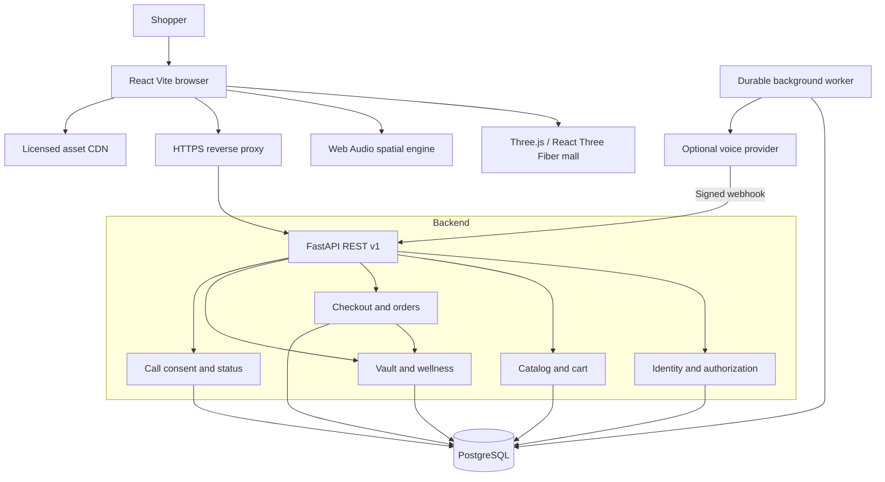
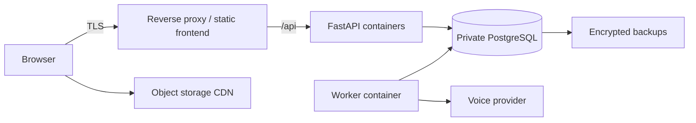

# System architecture — Whim Cart Dream
Version 1.0 | Proposed design | Supersedes legacy Lovable architecture.
## Architectural decision
Use a modular monolith with a separate React 19/TypeScript/Vite browser frontend and Python 3.12+ FastAPI backend. PostgreSQL is the authoritative store. A durable database-backed worker handles accrual, simulated fulfillment and calls. This minimizes deployment complexity and enables atomic financial transactions; microservices would add distributed consistency and operational overhead prematurely. Modules communicate through typed service interfaces, not each other's HTTP endpoints.

## Layers and boundaries
Frontend: feature modules account, catalog, cart, checkout, orders, vault, mall, audio; accessible 2D alternative; React Query and generated OpenAPI client proposed. Browser holds transient UI state only; server owns money and orders. Three.js/R3F/Drei render glTF assets with baked light, LOD, compressed textures and collision boundaries. Web Audio API handles opt-in spatial ambience; no audio autoplay. Use custom retail typography, natural materials, subtle motion, no game HUD or reward animations.
Backend: routers validate Pydantic schemas and identity; services implement use cases; repositories use SQLAlchemy 2; Alembic manages schema. Modules identity, catalog, commerce, vault, wellness, calls, assets and jobs. Dependency direction router -> service -> repository; domain logic independent of HTTP. PostgreSQL transactions encompass order, debit and outbox. Worker claims jobs with SKIP LOCKED, lease expiry, retry/backoff and dead-letter state; external calls outside DB transactions with provider idempotency where available. Redis/Celery optional later.
## Deployment

Local compose currently provisions DB only. Future compose adds API and worker; staging and production separate credentials and databases. Same-origin proxy, TLS, secrets manager, health/readiness checks, migrations before rollout, backups and restore drill. Main-only workflow per owner; CI validates before release; use revert commits, no force push.
## API contracts
All paths under /api/v1. POST auth/register, login, logout; GET/PATCH me/preferences, DELETE me; GET products, products/{id}, mall/manifest; GET cart, PUT/DELETE cart/items/{variant_id}; GET/PUT wishlist; POST checkout/quote and orders; GET orders and orders/{id}; POST orders/{id}/cancel; GET vault, vault/transactions, vault/budget, wellness; PUT wellness/goal; POST/GET orders/{id}/calls; POST webhooks/voice. Cursor pagination, structured error codes, ownership checks, idempotency keys. 401 unauthenticated, 403 forbidden, 404 missing, 409 insufficient funds/stale quote/conflict, 422 validation, 429 rate limit. Server calculates prices and totals.
## Checkout sequence
```mermaid
sequenceDiagram
 actor U as Shopper
 participant B as Browser
 participant F as FastAPI
 participant D as PostgreSQL
 participant W as Worker
 U->>B: Confirm simulated purchase
 B->>F: POST orders (quote ID, idempotency key)
 F->>D: Begin transaction; lock vault and cart
 F->>D: Validate quote, ownership, balance
 alt Valid and sufficient
 F->>D: Insert order, debit, event, outbox; clear cart; commit
 F-->>B: Order and updated balance
 W->>D: Claim committed event
 W->>D: Advance simulated order state
 else Invalid
 F->>D: Rollback
 F-->>B: 409 with reason
 end
```
## Security and resilience
Argon2id password hashing or managed identity; opaque server sessions in Secure HttpOnly SameSite cookies, CSRF token, session rotation and revocation. Per-resource authorization, CSP, input limits, rate limits, signed webhook and deduplication, encrypted phone data, no real card/address fields. No secrets in public Git. Structured redacted logs, correlation IDs, ledger reconciliation, outbox lag alerts. Fail closed on insufficient balance; call failure never blocks order. Restore and rollback tested. Provisional targets: 100 concurrent pilot users, ordinary read p95 <300ms, LCP <=2.5s on representative 2D mobile, 30 FPS on defined mid-tier 3D device; WCAG 2.2 AA for 2D.
## Status and dependencies
Only FastAPI health route, Vite landing scaffold and DB compose service exist today. All other modules are planned. See DATABASE_ARCHITECTURE.md, SRS.md, USER_STORIES.md, USE_CASE_DIAGRAM.md. Voice provider, assets, currency and policy amounts require approval.
