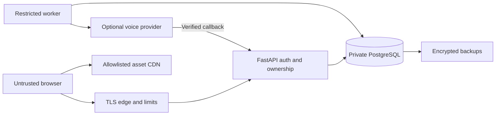

# Threat model
Design-stage STRIDE assessment; no exploit validation. Assets: credentials, sessions, email, phone, shopping and wellness history, virtual ledger, provider credentials and operating budget.

| Threat | Boundary and impact | Control |
|---|---|---|
| Spoofing | Browser to API; account takeover | SR01-03 |
| Tampering | Checkout, accrual, callbacks; incorrect balances | SR05-08 |
| Repudiation | Orders and administrative actions | SR14 |
| Disclosure | Cross-account queries, logs, backups, calls | SR01,04,08,10,12 |
| Denial of service | Expensive assets, auth, jobs and phone costs | SR02,04,07,09,13 |
| Elevation | Role injection, worker or CI compromise | SR01,04,10,11,13 |
Residual risks include compromised devices, provider breaches, dependency zero-days and human error. No risk accepted by default. Reassess on each new external integration and schema change.
