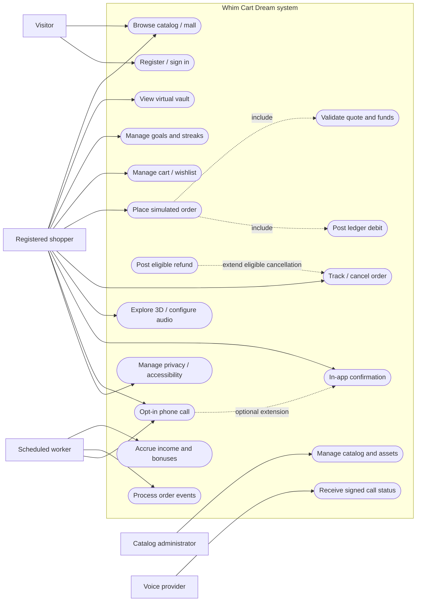
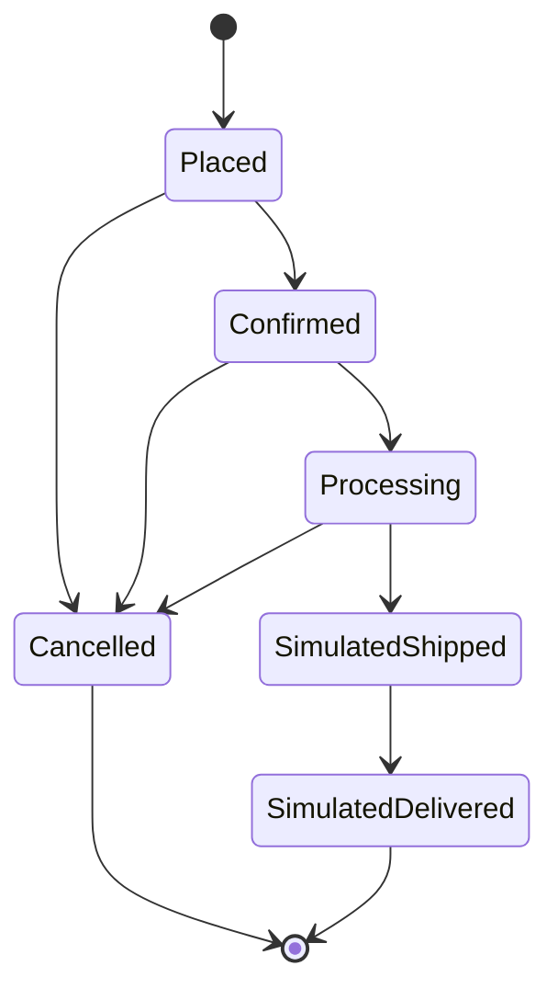

# Use case model
Version 1.0 | Mermaid flowchart represents UML-style actors and use cases (not native UML syntax).

## Actors
Visitor: anonymous browsing; shopper: authenticated owner of vault/cart/orders; administrator: authorized catalog and asset maintenance; worker: scheduled system actor; voice provider: external callback service. No bank, payment gateway, merchant or physical courier actor.
## Detailed use cases
| ID | Preconditions | Main flow | Alternatives / postcondition |
|---|---|---|---|
| UC01 | None | Open catalog, search, inspect product | Empty results or 2D fallback; no transaction |
| UC02 | Valid credentials or new email | Register/login, initialize vault once, issue session | Duplicate email/invalid credentials rejected; session established |
| UC03 | Authenticated | Fetch ledger and balance | Catch up accrual; no cross-user data |
| UC04 | Authenticated | Set voluntary goal, inspect eligibility | Pause/disable bonus; no confiscation |
| UC05 | Authenticated | Add variant, change quantity, save item | Invalid variant/quantity rejected; cart persists |
| UC06–08 | Authenticated, active cart, valid quote | Review disclosure, submit key, validate server total, lock vault, create order/debit/outbox, commit | Insufficient funds/stale quote -> rollback; retry returns same order |
| UC09–10 | Own order | View timeline or request eligible cancellation | Invalid transition rejected; eligible cancellation posts one refund |
| UC11 | Supported device or fallback | Enter store, navigate, select shelf product, optionally enable audio | Reduced motion/unsupported WebGL -> 2D; cart shared |
| UC12 | Own order | Show incoming call, accept and hear confirmation or decline | Transcript/failure fallback; order remains valid |
| UC13 | Own order, verified number, explicit active consent | Schedule call, check consent/window, invoke provider | Revoked consent, cost cap or failure -> no call; in-app alternative |
| UC14 | Authenticated for account actions | Update preferences, revoke consent, request deletion | Revoke sessions and remove contact data per policy |
| UC15 | Admin role | Validate product and asset license, publish/deactivate | Unauthorized or invalid asset rejected |
| UC16 | Active account and elapsed period | Lock account, calculate eligible periods, post unique credits | Retry no duplicate; missed streak never debits |
| UC17 | Committed outbox event | Claim lease, advance simulated status, record event | Retry/backoff; dead-letter alert |
| UC18 | Signed provider callback | Verify signature, dedupe event, update call state | Invalid signature rejected; duplicate ignored |
## Order state

Cancellation cutoff is proposed before simulated shipment; call state is independent.
